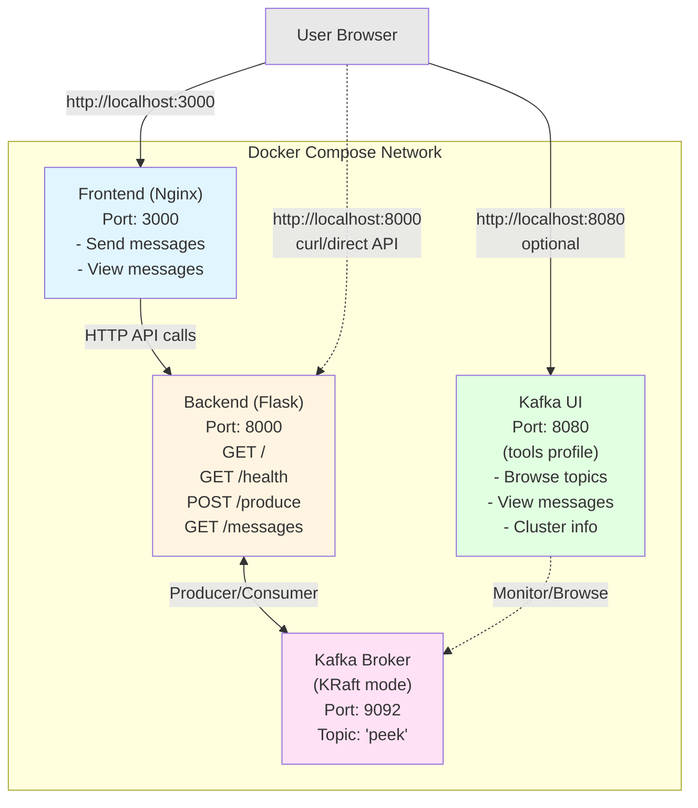

# topic_peek

Web application with a Flask backend and HTML/JS frontend for sending messages to a Kafka topic and viewing the latest messages.

## Architecture



**Flow:**
1. User opens frontend UI in browser (port 3000)
2. User sends message via form → Frontend calls POST `/produce` → Backend produces to Kafka
3. User clicks refresh → Frontend calls GET `/messages` → Backend consumes from Kafka
4. Optionally, user can view Kafka UI (port 8080) to browse topics and messages directly

## API Endpoints

### `GET /`
Health check endpoint.

**Response:** `"topic_peek is alive"`

### `GET /health`
Health status endpoint.

**Response:**
```json
{"status": "ok"}
```

### `POST /produce`
Produce a message to the Kafka topic.

**Request body (JSON):**
```json
{
  "message": "your custom message"
}
```

The `message` field is optional and defaults to `"hello"` if not provided.

**Response:**
```json
{"sent": "your custom message"}
```

**Examples:**
```bash
# Send a custom message
curl -X POST http://localhost:8000/produce \
  -H "Content-Type: application/json" \
  -d '{"message": "Hello Kafka!"}'

# Send with default message
curl -X POST http://localhost:8000/produce
```

### `GET /messages`
Retrieve the last 10 messages from the Kafka topic.

**Response:**
```json
{"messages": ["message1", "message2", "..."]}
```

**Example:**
```bash
curl http://localhost:8000/messages
```

## Project Structure

```
kafka_peek/
├── backend/          # Flask API
│   ├── main.py      # API endpoints: /health, POST /produce, GET /messages
│   ├── requirements.txt  # flask, flask-cors, kafka-python
│   └── Dockerfile   # Python 3.12 slim image
├── frontend/        # Web UI
│   ├── index.html   # Main HTML page
│   ├── style.css    # Styling
│   ├── app.js       # Frontend logic (no Kafka dependency)
│   └── Dockerfile   # Nginx alpine image
├── compose.yaml     # Orchestrates kafka, backend, frontend, and kafka-ui
├── .env             # Port configuration (KAFKA_UI_PORT, BACKEND_PORT, FRONTEND_PORT)
└── Makefile         # Commands: up, up-tools, down, logs, test
```

## Features

**Frontend (http://localhost:3000)**
- Send custom messages to Kafka via form input
- View the last 10 messages from the topic
- Refresh messages on demand
- Clean, responsive UI

**Backend API (http://localhost:8000)**
- `GET /health` - Health check
- `POST /produce` - Send message to Kafka
- `GET /messages` - Retrieve last 10 messages

**Kafka UI (http://localhost:8080) - Optional Tools Profile**
- Web-based Kafka management console
- Browse topics and messages
- View cluster information and broker details
- Monitor consumer groups
- Real-time message inspection

**Note:** Frontend communicates with Kafka only through the backend API - no direct Kafka dependency.

## Building and Running

**Requirements:** podman/docker with compose

```bash
# Build and start core services (kafka, backend, frontend)
make up

# Build and start with Kafka UI (optional tools profile)
make up-tools

# Test the backend API
make test

# View logs
make logs

# Stop all services
make down
```

### Compose Profiles

This project uses Docker Compose profiles to keep the default setup lean:

- **Default profile** (`make up`): Starts Kafka, backend, and frontend
- **Tools profile** (`make up-tools`): Includes Kafka UI web console for exploring topics, messages, and cluster info

### Environment Variables

Port configuration can be customized via `.env` file:

```bash
KAFKA_UI_PORT=8080      # Kafka UI web console
BACKEND_PORT=8000       # Flask backend API
FRONTEND_PORT=3000      # Frontend web UI
```

## Access Points

- **Frontend UI:** http://localhost:3000
- **Backend API:** http://localhost:8000
- **Kafka UI (tools profile):** http://localhost:8080
- **Kafka broker:** kafka:9092 (internal to compose network)

## Backend API Examples

```bash
# Send a custom message
curl -X POST http://localhost:8000/produce \
  -H “Content-Type: application/json” \
  -d '{“message”:”Hello Kafka!”}'

# Retrieve messages
curl http://localhost:8000/messages
```